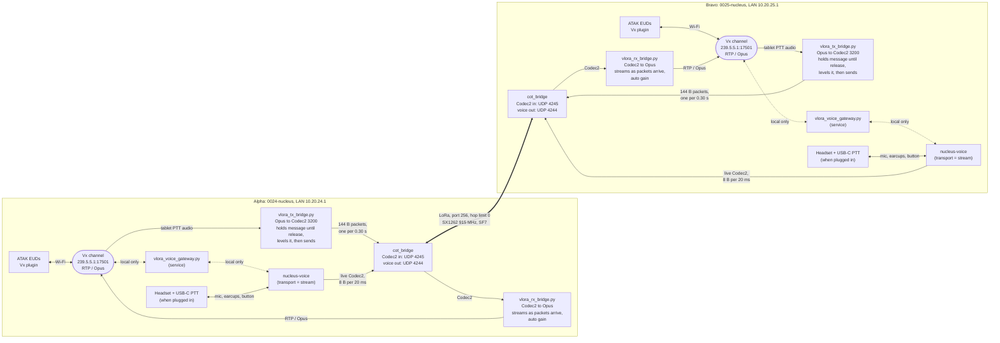

# VoiceOverLoRa (VLoRa)

Real-time push-to-talk voice over a LoRa radio link, delivered natively into ATAK's built-in Voice (Vx) plugin. No internet, no cellular, no additional apps on the end-user device. Operators press PTT in ATAK exactly as they normally would, and voice crosses the long-range LoRa link to reach teammates beyond Wi-Fi range.

An optional **hardware PTT headset** (a tactical headset on a USB-C PTT, plugged into a Nucleus node) joins the same voice channel, so a user without a tablet in hand can talk to and hear ATAK users over LoRa.

## Relationship to Natak Mesh / Nucleus

This project is an extension of, and depends entirely on, the Nucleus platform built by Natak Mesh. It is not a standalone product and will not function without a working Nucleus deployment.

Nucleus already provides:

- A high-speed Wi-Fi mesh carrying full ATAK functionality (SA, chat, voice, video) at close-to-medium range
- A parallel long-range LoRa mesh, bridged transparently into ATAK for situational awareness (position, chat, markers) via a built-in CoT bridge daemon
- ATAK Voice plugin support natively over the Wi-Fi mesh

What Nucleus does not do out of the box is carry ATAK voice over the long-range LoRa link. The LoRa side is built for low-bandwidth telemetry (CoT/SA/chat), not continuous audio. VLoRa adds that capability by bridging ATAK's Voice (Vx) plugin traffic into the existing LoRa CoT bridge, encoding it efficiently enough to survive LoRa's bandwidth limits, and decoding it back into native ATAK Voice on the receiving end.

In short: Nucleus gets you long-range SA and chat over LoRa. VLoRa adds long-range voice on top of that same link.

All credit for the underlying mesh platform, the CoT bridge architecture, the hardware PTT voice daemon (`nucleus-voice`) and the Nucleus hardware goes to Nathan at Natak Mesh. This project modifies and extends his `cot_bridge.py` daemon and requires a working Nucleus node to run.

## What This Solves

ATAK's Voice plugin (Vx) communicates over IP multicast (`239.5.5.1:17501`, RTP/Opus). This works natively across the Nucleus Wi-Fi mesh, but Opus is far too high-bandwidth for LoRa, which realistically carries hundreds of bits to a few kilobits per second depending on radio configuration. VLoRa solves this by:

1. Intercepting outgoing Vx voice traffic on the transmitting node
2. Transcoding it from Opus down to Codec2 3200 (a speech codec designed for very low bitrates, originally built for HF radio)
3. Carrying the Codec2 stream across the existing LoRa link
4. Transcoding it back to Opus on the receiving node and injecting it into the same ATAK Vx multicast group

The result: an operator presses PTT in ATAK on Node A, speaks, and a teammate on Node B, potentially miles away with no Wi-Fi connectivity between them, hears it through their normal ATAK Voice plugin.

## Architecture



Alpha and Bravo are symmetrical: each node runs the same five pieces (`cot_bridge`, both VLoRa bridges, `nucleus-voice` and the gateway service), and each can take a headset. Solid arrows carry voice that goes over LoRa; dotted arrows are the gateway's copies, which stay on their own node and are never sent over LoRa again. The only per-node differences are addresses: Alpha's LAN `10.20.24.1` and mesh `10.20.1.24`, Bravo's LAN `10.20.25.1` and mesh `10.20.1.25`. Another node follows the same pattern with its own number. There is no hub/spoke relationship: if one node goes down, the other keeps working on its own.

| Voice path | Over LoRa? |
|---|---|
| Tablet on Alpha → tablets on Bravo (and the reverse) | Yes: TX bridge → `cot_bridge` → LoRa → `cot_bridge` → RX bridge |
| Headset on Alpha → tablets and headset on Bravo (and the reverse) | Yes: `nucleus-voice` → `cot_bridge` → LoRa → RX bridge, then Bravo's gateway for its headset |
| Headset ↔ tablets on the same node | No: the gateway, local only |

### How a transmission travels

| Step | ATAK user (tablet PTT) | Headset user (hardware PTT) |
|---|---|---|
| Capture | Vx sends RTP/Opus to `239.5.5.1:17501` | `nucleus-voice` records the headset mic while the button is held |
| Encode | `vlora_tx_bridge.py` decodes Opus, resamples to 8 kHz and holds the whole message until PTT is released. It then levels it (one gain for the message) and encodes Codec2 3200 | `nucleus-voice` encodes Codec2 3200 live, 8 bytes per 20 ms |
| Hand-off | 144 B packets (0.36 s of audio each) to `cot_bridge` on UDP 4245, one every 0.30 s, with a silence packet first and silence padding last | Each 8 B frame goes to UDP 4245 as soon as it's encoded |
| Over the air | `cot_bridge` sends INIT, then the voice packets, then TERM after 0.5 s without input, on LoRa port 256 with hop limit 0 | Same |
| Receive | Far `cot_bridge` passes Codec2 to `vlora_rx_bridge.py` on UDP 4244. It decodes as packets arrive, applies auto gain, and injects RTP/Opus into the local Vx channel. A gap over 1.0 s ends the stream | Same |
| Listener hears it | After the talker finishes: delay is about message length + 1 s | While the talker is still speaking: about 1 s behind |

## Hardware Requirements

- Two or more Nucleus nodes (Raspberry Pi + RAK4631 LoRa module, per Natak Mesh's build)
- LoRa radio: SX1262, 915 MHz (or regional equivalent), configured per the notes below
- ATAK end-user devices (EUDs) connected to each Nucleus node's Wi-Fi access point
- Optional, per node: a headset and a USB-C PTT that `nucleus-voice` recognizes. Tested with an Earmor M32 on a Bifrost Gear Valhalla PTT for USB-C smartphones (it enumerates as `Generic NBT POC`, USB ID `0020:0b21`, with a mic, earcup playback and a hold-to-talk button)

## Software Components

| File | Runs on | Purpose |
|---|---|---|
| `shared/cot_bridge.py` | Both nodes | Modified Nucleus LoRa CoT bridge. Adds a raw Codec2 UDP input (port 4245) and forwards decoded LoRa voice to UDP port 4244. All existing CoT/SA/chat functionality is untouched; the changes are additive only. On V3_OS the built-in `nucleusd` cot_bridge provides this (see `v3os/`). |
| `alpha/vlora_tx_bridge.py`, `bravo/vlora_tx_bridge.py` | Per node | Captures ATAK Vx RTP/Opus PTT traffic, transcodes to Codec2 and hands it to `cot_bridge` in paced 144 B packets. Ignores traffic from its own node's IP, so locally injected voice is never sent twice. |
| `alpha/vlora_rx_bridge.py`, `bravo/vlora_rx_bridge.py` | Per node | Receives Codec2 voice from `cot_bridge`, transcodes back to Opus/RTP and injects it into the local ATAK Vx channel. Streaming decode: audio starts playing as packets arrive. |
| `alpha/vlora_voice_gateway.py`, `bravo/vlora_voice_gateway.py` | Per node (for a headset) | Links `nucleus-voice` (the headset) with the local Vx channel, so tablets on the same node hear the headset and the headset hears ATAK and LoRa voice. Keeps `nucleus-voice` on LoRa streaming. Local to the node: it never transmits on LoRa. The same file on every node; addresses are passed on the command line. Harmless on a node with no headset. |
| `*/vlora-tx-bridge.service`, `*/vlora-rx-bridge.service` | Per node | systemd units so both bridges start on boot and restart on failure. |
| `alpha/vlora-voice-gateway.alpha.service`, `bravo/vlora-voice-gateway.bravo.service` | Per node | systemd unit for the gateway, with that node's addresses. Installed as `/etc/systemd/system/vlora-voice-gateway.service`. |
| `v3os/` | V3_OS nodes | Deployment notes, service units and the `cot_bridge` sender-prefix patch for V3_OS. |

The `alpha` and `bravo` folders hold functionally identical scripts. The only difference is the node's local IP address, set as a constant (`VX_BIND_IP`, `MCAST_IF_IP`, `LOCAL_NODE_IP`). Deploying to another node means copying either folder and updating those constants.

## Hardware PTT Headset (optional)

V3_OS ships a voice daemon, `nucleus-voice` (`nucleusd.voice.daemon`), with built-in support for USB PTT adapters. When a supported adapter is plugged in, it takes the adapter's mic, earcups and button automatically (it logs `NBT POC attached`). VLoRa uses it as-is and adds a small gateway on the node.

**One-time install, on every node** (the gateway waits harmlessly on a node with no headset, so the headset can move between nodes):

```
sudo cp vlora_voice_gateway.py /opt/nucleus/vlora/
sudo cp vlora-voice-gateway.<node>.service /etc/systemd/system/vlora-voice-gateway.service
sudo systemctl daemon-reload
sudo systemctl enable --now vlora-voice-gateway
sudo journalctl -u vlora-voice-gateway -n 10 --no-pager
```

The journal should end with `nucleus-voice answering (transport stream, headset attached)` (or `not attached`). For another node, copy a service file and set `--vx-if 10.20.<n>.1 --mesh-if 10.20.1.<n> --daemon-node <n>` on its `ExecStart` line.

**Using it:**

1. Plug the PTT adapter into the node, with the headset connected to it. The gateway logs `headset attached: card N`.
2. That's it. `nucleus-voice` starts on transport `ip` (Wi-Fi mesh only) every time it launches; the gateway checks every 5 s and switches it to `stream` (it logs `transport ip -> stream`). To check by hand: `echo -n STATUS | nc -u -w1 127.0.0.1 5556`, looking for `"hardware": true` and `"transport": "stream"`.

**Use:** hold the PTT button, speak, release. Over LoRa the far end hears you live, about a second behind. Tablets on the same node hear you through the gateway. Incoming ATAK and LoRa voice plays in the earcups, with automatic gain.

**How the gateway works:**

- **Headset to ATAK:** it copies `nucleus-voice`'s 8 B Codec2 frames off the loopback interface (`cot_bridge` still receives the originals), decodes them and sends them into the Vx channel from the node's own IP. `vlora_tx_bridge.py` ignores that IP, so nothing is sent over LoRa twice.
- **ATAK to headset:** it decodes Vx voice (tablets and LoRa voice from `vlora_rx_bridge.py`), applies automatic gain and hands it to `nucleus-voice` with multicast TTL 0, so it stays on the node.
- **Keeps the transport:** it asks `nucleus-voice` for its status every 5 s and sets `stream` if a restart reset it. `--transport off` leaves the setting alone.
- If any part fails (for example the network isn't up yet at boot), it exits and systemd restarts it after 5 s.
- Each received message is logged with its level and saved to `/tmp/vgw/` for checking.

## LoRa Radio Configuration (important)

Voice over LoRa is bandwidth-constrained in a way that CoT/SA/chat traffic is not. The spreading factor (SF) chosen for the radio link directly determines whether real-time voice is usable.

Nucleus's stock LoRa configuration is tuned for range and penetration (e.g. SF11). That's correct for infrequent small CoT/SA/chat packets, but each packet takes far too long on air to carry continuous voice: a few seconds of speech can take 15–20+ seconds to clear the air at high SF, with heavy packet loss as transmissions queue faster than the radio can send them.

Running voice reliably in real time requires a faster spreading factor (SF7–SF9), which trades maximum range and penetration for throughput. Development and bench testing use Meshtastic's SHORT_FAST preset (SF7).

Both nodes on a link must use matching SF and bandwidth. This is a radio-level setting that affects every packet on the link, not something set per application.

This is a deliberate range-versus-speed tradeoff. Make it consciously, based on your operational distance, rather than leaving the long-range default if real-time voice is a requirement. See `VLoRa_LoRa_Statistics.docx` for the LoRa airtime calculations behind this.

## ATAK Device Setup

VLoRa itself needs no plugin installation; it rides entirely on ATAK's Voice (Vx) plugin. However, Vx is a separate plugin from core ATAK and isn't bundled on every device or build. Setup happens once per device, per mission or channel:

1. **Install the TAK Voice (Vx) plugin** on every ATAK device that will use voice. It is downloaded and installed separately from core ATAK. If it's missing, no voice channel options appear in ATAK.
2. **Connect the device to the Nucleus node's Wi-Fi access point.** Each node broadcasts its own AP; connect to whichever node the operator is near.
3. **Set the device's active network interface to `wlan0`** (the Nucleus Wi-Fi interface), not cellular, a second Wi-Fi or another adapter. ATAK and Vx bind to whichever interface is selected in ATAK's network preferences. On the wrong interface, voice never reaches the node, even though the device shows as connected to the AP. This is a common silent failure; check it first.
4. **Open the Vx (Voice) plugin** inside ATAK.
5. **Configure a multicast voice channel:**
   - Address: `239.5.5.1`
   - Port: `17501`
   - Protocol: `RTP`

   These must match exactly on every device and node. It's the standard Vx multicast channel Nucleus and ATAK already use over the Wi-Fi mesh; VLoRa extends the same channel over LoRa.
6. **Enter the channel** by tapping its name in the channel list. Configuring or viewing a channel is not the same as being inside it. The PTT button only appears on the ATAK map, and the device only joins the `239.5.5.1` multicast group (verifiable via IGMP), once the channel has been entered. No PTT button on the map means the device will neither send nor receive VLoRa audio.
7. **Confirm the PTT button is visible on the map.** That's the reliable sign the device has joined the voice channel.

If voice fails on one device, check in this order: Vx plugin installed, then the right network interface (`wlan0`), then the device actually inside the channel (PTT button visible).

Once joined, voice works exactly like normal ATAK Voice: press and hold PTT, speak, release. There's no separate channel for "LoRa voice" versus "Wi-Fi voice"; it is one Vx channel carried over two transports.

## Dependencies

System packages (both nodes):

```
ffmpeg
codec2
```

Python (virtual environment recommended; on V3_OS, `/opt/nucleus/venv`):

```
opuslib
pycodec2
soxr
numpy
```

## Measured Performance (bench, SHORT_FAST / SF7)

| Measure | Result |
|---|---|
| Packet loss, 144 B packets at 0.30 s spacing | 3.3–3.9% over 25 runs (earlier 72 B design: 17–30%) |
| Where loss happens | Mostly the first one or two packets after INIT (usually the silence packet); occasional bursts of 2–4 packets that cause audible chops (cause still under investigation) |
| ATAK to ATAK delay | About message length + 1 s (message held until release) |
| Headset to ATAK delay | About 1 s behind the talker (live streaming); not precisely measured yet |
| Tablet voice level | Varies by about 36 dB between messages (about −22 to −58 dBFS) depending on the phone's audio state; levelling and auto gain even it out |

## Known Limitations

- Voice quality and latency are governed by the LoRa link's spreading factor (see above). This is a physical constraint of LoRa, not a software limitation. At long range or high SF, voice will be choppy or badly delayed.
- TX and RX bridges must match on every node. Mismatched encoder and decoder implementations (e.g. one node on a subprocess-based Codec2 path, the other on a different library) can produce unintelligible audio even on a healthy link. Always deploy matching bridge versions to every node.
- One talker at a time. Two people transmitting at once garble each other at the far end.
- Hardware PTT: `nucleus-voice` returns to `transport ip` whenever it restarts. The gateway puts it back within about 5 s, so a transmission in those first seconds after a restart goes over the Wi-Fi mesh only.
- The gateway holds `nucleus-voice` on `stream`. Choosing another transport in the Nucleus UI is undone within 5 s unless the gateway is stopped or run with `--transport off`.
- On V3_OS, `nucleus-voice` and `vlora_rx_bridge.py` both bind UDP 4244, and only one of them receives incoming LoRa voice (on the tested nodes, `vlora_rx_bridge.py`). The gateway is what gets that voice to the headset.

## Status

- **Working:** ATAK voice in both directions between two Nucleus nodes at SF7. A hardware PTT headset talking to and hearing ATAK users on another node over LoRa, and on its own node through the gateway. The gateway runs as a service on both nodes and keeps `nucleus-voice` on LoRa streaming.
- **Being deployed:** TX-side message levelling and RX-side auto gain in the bridges (bench-tested; packet format unchanged, so mixed versions still interoperate).
- **Next:** reboot test of the gateway service, headset tests on the second node, burst-loss investigation, start-up loss fix, and field range testing at lower spreading factors.

## Acknowledgments

Built on top of, and entirely dependent on, Nucleus by Natak Mesh. This project would not exist without Nathan's mesh, CoT bridge and voice platform. VLoRa is a voice extension layered on his work, not a replacement for or independent alternative to it.
